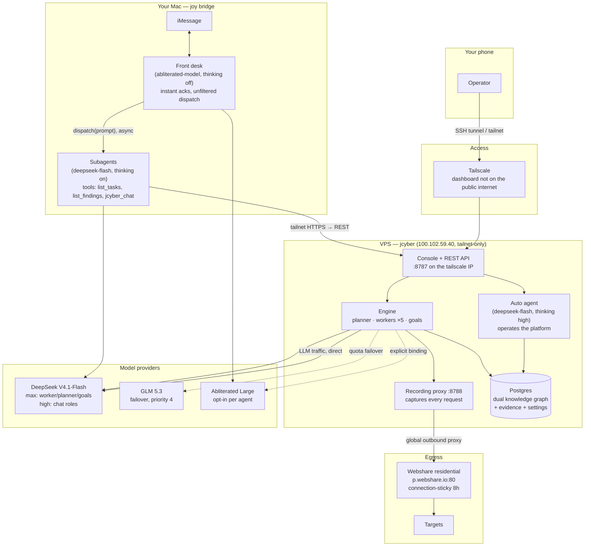
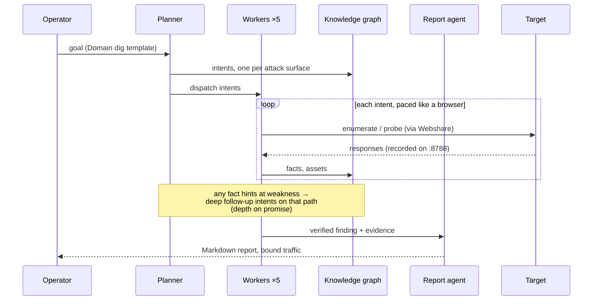

# jcyber architecture

How every piece talks to every other piece. Boxes run in three places: your
phone, your Mac, and one VPS. Nothing else is required.

## The whole system

## A task, start to finish

## What runs where

| Where | Process | Notes |
|---|---|---|
| Phone | iMessage client | the only operator surface needed |
| Mac | `joy` bridge (`bun start`) | iMessage front desk; needs Messages logged in |
| VPS | jcyber binary | dashboard bound to the tailscale IP only |
| VPS | Postgres (docker) | schema self-migrates on boot |
| VPS | Webshare egress | set in System Settings, not env |

## Model tiers

| Tier | Model | Used by |
|---|---|---|
| max | deepseek-flash | workers, planner, goals — every reasoning turn |
| high | deepseek-flash | Auto, mainagent, reporter, retester, pentest |
| failover | glm-5.3 | automatic when DeepSeek quota dies |
| opt-in | abliterated-model-large-v2 | bind per agent when wanted; also the front desk (smallest variant) |

## Safety rails

- **Console**: tailscale-only bind; the public IP answers nothing on 8787
- **Target traffic**: always through the residential gateway, connection-sticky
- **Workers**: code-fixed stealth discipline (browser UAs, randomized pacing,
  sample-first enumeration, no full-speed mode)
- **Destructive commands**: interception rules hold them for approval
- **Tests**: run against a dedicated `jcyber_test` database, never the console
