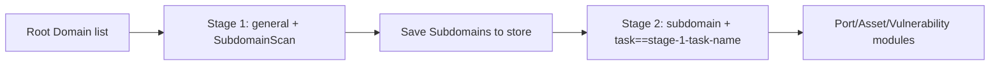

---

## name: scopesentry-mcp
description: Manage the security scanning platform (projects, Tasks, templates, Assets, nodes) through ScopeSentry MCP. Use when users mention ScopeSentry, MCP, API Keys, scanning Tasks, or Asset queries.

# ScopeSentry MCP User Guide

For users with a **deployed ScopeSentry instance**. Connect to the platform through Cursor (or another MCP client); no local source code is required.

## 1. Prerequisites

### 1.1 Confirm Service Availability

- Default Web interface: `http://<host>`
- MCP Endpoint: `http://<host>/mcp` (if a reverse proxy or frontend proxy is used, use the actual `/mcp` address)

### 1.2 Create an API Key

1. Sign in to the ScopeSentry Web interface in a browser
2. Open **API Key** management and create a Key (or use an endpoint provided by the administrator)
3. Save the returned `ssk_...` string (**shown only once**)

### 1.3 Configure Cursor MCP

Cursor → Settings → MCP → Add Server:

```json
{
  "mcpServers": {
    "scopesentry": {
      "url": "http://<your-host>:8082/mcp",
      "headers": {
        "X-API-Key": "ssk_your_key"
      }
    }
  }
}
```

Alternatively use: `Authorization: Bearer ssk_your_key`

After configuration, restart MCP or reload Cursor and confirm that `list_projects`, `list_assets`, etc. appear in the tool list.

---

## 2. Tool Overview


| Tool                     | Purpose                |
| ---------------------- | ----------------- |
| `list_projects`        | Project tree grouped by tags (including project IDs) |
| `list_projects_data`   | Paginated project list, searchable by name |
| `get_project`          | Project details |
| `create_project`       | Create a project |
| `list_tasks`           | Scanning Task list |
| `get_task`             | Task details |
| `list_scan_templates`  | Scan template list |
| `get_scan_template`    | Template details |
| `list_plugin_modules`  | Scan pipeline module names |
| `list_plugins`         | Available plugins (including hashes and default parameters) |
| `create_scan_template` | Create a scan template |
| `create_scan_task`     | Create a scanning Task |
| `list_assets`          | Query Assets of each type (paginated list) |
| `count_assets`         | Count Assets (`/api/assets/common/total`) |
| `get_asset_detail`     | Asset or Vulnerability details |
| `add_asset_tag`        | Add tags to Assets |
| `list_nodes`           | Scanning node list |


The MCP tool descriptions (schemas) define each tool's parameters. `list_assets` / `count_assets` share search and filter syntax; read the `list_assets` description before querying Assets.

To find the total count, use `count_assets` (the Web pagination total endpoint), rather than repeatedly paging through `list_assets`.

---

## 3. Common Workflows

### 3.1 Query Assets by Project

When the user or context **already specifies a project**, prefer `filter.project` to narrow the scope and avoid slow responses from excessive cross-project data. If no project is specified, a project filter is not required.

1. Use `list_projects` or `list_projects_data` to get the target project's **ObjectID** (`id` / `children[].value`)
2. Pass `filter.project` to `list_assets` (**must be an ID, not a project's Chinese name**)

```json
{
  "asset_type": "asset",
  "pageIndex": 1,
  "pageSize": 20,
  "search": "domain=^example.com",
  "filter": {
    "project": ["<projectObjectID>"]
  }
}
```

### 3.2 Create a Scanning Task

1. Use `list_nodes` to get online node names
2. Use `list_scan_templates` or `create_scan_template` to get a template **ObjectID**
3. `create_scan_task`: `name` and `node` are required; set `template` to the template ID (not its name)

**Target source `targetSource` (same as the Web interface):**

| targetSource | Description | Required Parameters |
| --- | --- | --- |
| `general` | Enter targets directly | `target` |
| `project` | Read targets from projects | `project` (array of project ObjectIDs) |
| `asset` | Search the Web Asset store | `search`; optional `project`, `filter`, `targetNumber` |
| `RootDomain` | Search the root Domain store | `search`; optional `project`, `filter`, `targetNumber` |
| `subdomain` | Search the Subdomain store | `search`; optional `project`, `filter`, `targetNumber` |
| `UrlScan` | Search URL scan results | `search`; optional `project`, `filter`, `targetNumber` |
| `*Source` (such as `subdomainSource`) | Create from "selected/search" on an Asset page | Use `search` when `targetTp=search`; use `targetIds` when `targetTp=select` |

**Example — Scan root Domains directly:**

```json
{
  "name": "example-subdomain-collection",
  "node": ["node-1"],
  "template": "<templateObjectID>",
  "targetSource": "general",
  "target": "example.com\nfoo.com",
  "project": ["<projectObjectID>"]
}
```

**Example — Continue scanning from the Subdomain store (filter by the previous Task name):**

```json
{
  "name": "example-ports-and-vulnerabilities",
  "node": ["node-1"],
  "template": "<subsequentModuleTemplateObjectID>",
  "targetSource": "subdomain",
  "search": "task==\"example-subdomain-collection\"",
  "project": ["<projectObjectID>"]
}
```

### 3.3 Complete Root Domain Reconnaissance (Two Stages Recommended)

When the input is **root Domains** and **complete reconnaissance** is required, use two scans rather than running the entire pipeline at once.

**Reason:** Distributed Tasks are assigned per **individual target**. When a root Domain is assigned to a node, the Subdomains discovered by that node also run subsequent modules on that same node, often causing uneven load, slow execution, and errors.

**Best practice:**

1. **Stage 1 — Subdomain collection only**
   - `targetSource`: `general`
   - `target`: all root Domains (multiple lines)
   - Template: enable only `SubdomainScan` and `SubdomainSecurity` (Subdomain scanning + Subdomain takeover)
   - Use `get_task` to wait for completion

2. **Stage 2 — Subsequent modules**
   - `targetSource`: `subdomain`
   - `search`: `task=="<stage-1-task-name>"` (exact Task name match)
   - Optionally narrow the scope with `project`
   - Template: Port scanning, Asset mapping, Vulnerability scanning, etc. (`SubdomainScan` may be omitted)
   - Subdomains are distributed as independent targets across nodes for better parallel efficiency

Alternatively, filter by Task name on the Web "Subdomain" Asset page and use "Create Task from Subdomains" for the same result.



### 3.4 Create a Scan Template

1. `list_plugin_modules` → module names
2. `list_plugins` (optionally filter by `module`) → each plugin's `hash` and default `parameter`
3. `create_scan_template`: use `modules` to specify "module → array of plugin hashes"

---

## 4. Asset Queries (`list_assets` / `count_assets`)

`count_assets` uses the same `asset_type`, `search`, and `filter` as `list_assets`, returns `{ "total": N }`, and corresponds to `/api/assets/common/total` in the Web interface.

```json
{
  "asset_type": "subdomain",
  "search": "task==\"some-task-name\"",
  "filter": {"project": ["<projectObjectID>"]}
}
```

**Performance advice (for both `list_assets` / `count_assets`):** When a project is specified, prefer `filter.project` to narrow the scope. For indexed fields in `search`, use `==` equality or `^` prefix matching where possible (see [4.3](#43-search-expressions)); avoid broad `=` fuzzy queries that slow responses. Without project context, a project filter is not required.

Types supporting `filter.project` are listed in [4.4](#44-filter-exact-filtering).

### 4.1 Asset Types `asset_type`

`asset`、`RootDomain`、`subdomain`、`app`、`mp`、`UrlScan`、`SensitiveResult`、`DirScanResult`、`crawler`、`vulnerability`、`PageMonitoring`、`IPAsset`、`SubdomainTakerResult`

Alias examples: `web`→asset, `vuln`→vulnerability, `ip`→IPAsset, `url`→UrlScan

### 4.2 Parameter Descriptions


| Parameter                       | Description                                      |
| ------------------------ | --------------------------------------- |
| `pageIndex` / `pageSize` | Pagination; defaults to 1 / 20 |
| `search`                 | Search expression (see below) |
| `filter`                 | Exact-filter JSON (see below) |
| `sort`                   | Only UrlScan and DirScanResult support sorting by `length` |
| `sid`                    | SensitiveResult only: sensitive-data rule name |


`search` and `filter` **can be used together**.

### 4.3 search Expressions

Custom DSL (**not SQL**):


| Operator  | Meaning   | Index | Example                          |
| ---- | ---- | ---- | --------------------------- |
| `=`  | Fuzzy matching (regex) | No index | `domain=example`            |
| `==` | Exact matching (equality) | **Uses index** | `port==443`                 |
| `!=` | Exclude   | — | `port!="80"`                |
| `&&` | AND    | — | `domain==example.com && port==443` |
| `||` | OR    | — | `title=admin || body=login` |


**Indexes and operators:** Fields such as `domain`, `ip`, `port`, and `title` are indexed, but only **`==` equality** or **prefix matching with a value beginning with `^`** (such as `domain=^example.com`) can use indexes. **`=` becomes a fuzzy regex match and cannot use indexes**, which can be slow with large datasets.

**search fields shared by all types:** `tag`, `task` (Task name), `rootDomain`

**Do not put project in search** (it is invalid or causes an error when combined with `&&`). Use `filter.project` to filter projects.

**Common search fields by type:**


| asset_type           | Fields                                                                                  |
| -------------------- | ----------------------------------------------------------------------------------- |
| asset                | domain, ip, port, service, app, title, statuscode, icon, banner, type, body, header |
| RootDomain           | domain, icp, company                                                                |
| subdomain            | domain, ip, type, value                                                             |
| app                  | name, icp, company, category, description, url, apk                                 |
| mp                   | name, icp, company, category, description, url                                      |
| UrlScan              | url, input, source, resultId, type                                                  |
| SensitiveResult      | url, sname, body, info, md5                                                         |
| DirScanResult        | url, statuscode, redirect, length                                                   |
| vulnerability        | url, vulname, matched, request, response, level                                     |
| crawler              | url, method, body, resultId                                                         |
| PageMonitoring       | url, hash, diff, response                                                           |
| IPAsset              | ip, domain, port, service, webServer, app                                           |
| SubdomainTakerResult | domain, value, type, response                                                       |


**search examples:**

- `domain==www.example.com && port==443` (equality; uses index)
- `domain=^example.com` (prefix match; uses index)
- `ip==192.168.1.1`
- `task=="some-task-name"`
- `level==high` (vulnerability)
- `statuscode==200` (DirScanResult)

Use `=` only when a fuzzy contains match is needed, such as `title=admin` (no index; narrow the scope with project or other conditions).

### 4.4 filter Exact Filtering

JSON object: multiple values for the same key use **OR**; different keys use **AND**.

**Prefer `project` when project criteria are available:** If the user or context specifies a project and asset_type supports `project`, include it to narrow the scope; it is not required when no project information is available.


| filter key   | Meaning       | Value Description                                                     |
| ------------ | -------- | -------------------------------------------------------- |
| `project`    | Owning project | **ObjectID** from `list_projects` / `list_projects_data` |
| `task`       | Source Task | **Task name** from `list_tasks`'s `name` |
| `port`       | Port | Such as `"443"` |
| `service`    | Service/protocol | Such as `"https"` |
| `app`        | Application fingerprint | Such as `"Nginx"` |
| `icon`       | Icon hash | |
| `statuscode` | HTTP status code | Primarily for asset |
| `status`     | Status | UrlScan/DirScan HTTP codes; handling status for Vulnerabilities/sensitive data |
| `level`      | Vulnerability severity | critical / high / medium / low / info |
| `type`       | Type | Such as Subdomain record types A, CNAME |
| `color`      | Sensitive-data rule color | SensitiveResult |
| `sname`      | Sensitive-data rule name | SensitiveResult |
| `tags`       | Tags | |


**Available filter keys by type:**


| asset_type                            | filter key                                                      |
| ------------------------------------- | --------------------------------------------------------------- |
| asset                                 | project, port, service, app, icon, statuscode, type, task, tags |
| RootDomain                            | project, tags                                                   |
| subdomain                             | project, type, task, tags                                       |
| app / mp                              | project, tags                                                   |
| UrlScan                               | status, tags                                                    |
| DirScanResult                         | status, tags                                                    |
| SensitiveResult                       | status, color, sname, tags                                      |
| crawler                               | project, task, tags                                             |
| vulnerability                         | project, level, status, task, tags                              |
| PageMonitoring / SubdomainTakerResult | tags                                                            |
| IPAsset                               | project, port, service, app                                     |


**filter example:**

```json
{"project": ["<projectObjectID>"], "port": ["443"]}
```

**Combined query example:**

```json
{
  "asset_type": "asset",
  "search": "domain=^baidu && port==443",
  "filter": {"project": ["<projectObjectID>"]},
  "pageIndex": 1,
  "pageSize": 10
}
```

**Notes:**

- Prefer `filter.project` when project criteria are available (if supported); it is optional without project context
- Do not put project display names in `filter.project`
- Use `==` for known values and `^` for prefixes; avoid excessive `=` fuzzy matches on large tables
- Use `filter.status` for UrlScan HTTP status; DirScanResult supports `statuscode==200` in search
- For SensitiveResult rule names, use `sname=rule-name` in `search`, or `filter.sname`

### 4.5 Sorting with sort

Supported only by **UrlScan** and **DirScanResult**:

```json
{"length": "ascending"}
```

Other types ignore `sort` and use the default time-based ordering.

---

## 5. Scan Template Module Names

`TargetHandler`、`SubdomainScan`、`SubdomainSecurity`、`PortScanPreparation`、`PortScan`、`PortFingerprint`、`AssetMapping`、`AssetHandle`、`URLScan`、`WebCrawler`、`URLSecurity`、`DirScan`、`VulnerabilityScan`、`PassiveScan`

---

## 6. Troubleshooting


| Symptom        | Action                                                 |
| --------- | -------------------------------------------------- |
| No MCP tools | Check the URL, API Key, and whether ScopeSentry is running |
| 401 / 403 | Recreate or replace the API Key |
| Assets not found | Confirm `filter.project` is an ObjectID; do not put project in search |
| Template/Task creation fails | `template` must be a template ObjectID; `node` must contain online node names |
| Query slow/stuck | Add `filter.project` when a project is available; use `==` or `^` prefixes for indexed search fields, minimize `=`; reduce `pageSize` |


---

